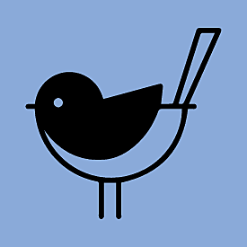

<!-- [[[cog
import cog
from nbconvert.exporters import MarkdownExporter
from nbconvert.preprocessors import RegexRemovePreprocessor

rrp = RegexRemovePreprocessor()
rrp.patterns = (r"<style>",)
e = MarkdownExporter()
e.register_preprocessor(rrp, enabled=True)
(body, resources) = e.from_filename("welcome.ipynb")
cog.out(f"\n{body}\n")
]]] -->

<h1><center>Welcome to MadPy!</center></h1>
<br>
<center></center>

# Organizers

<table style="border:none; border-collapse:collapse; cellspacing:0; cellpadding:0">
  <tr>
    <td></td>
    <td></td>
    <td></td>
  </tr><tr>
    <td><p class="caption">Ed Rogers</p></td>
    <td><p class="caption">David Hoese</p></td>
    <td><p class="caption">Josh Karpel</p></td>
  </tr>
</table>

# Code of Conduct

**MadPy is a community group** and open to all experience levels. We are committed to **a safe, professional environment**

### Our Commitment to You

We are enthusiastically focused on improving our event and making it a place that is welcoming to all. All reports will be taken seriously, handled respectfully, and dealt with in a timely manner.

Learn more about the MadPy Code of Conduct:

https://github.com/madison-python/code-of-conduct


# Python Warm-Up

```text
            Poe, E.
          Near a Raven

Midnights so dreary, tired and weary.
    Silently pondering volumes extolling all by-now obsolete lore.
During my rather long nap - the weirdest tap!
    An ominous vibrating sound disturbing my chamber's antedoor.
        "This", I whispered quietly, "I ignore".

Perfectly, the intellect remembers: the ghostly fires, a glittering ember.
    Inflamed by lightning's outbursts, windows cast penumbras upon this floor.
Sorrowful, as one mistreated, unhappy thoughts I heeded:
    That inimitable lesson in elegance - Lenore -
        Is delighting, exciting...nevermore.
```

Make this poem a variable:


```python
poem_text = """
            Poe, E.
          Near a Raven

Midnights so dreary, tired and weary.
    Silently pondering volumes extolling all by-now obsolete lore.
During my rather long nap - the weirdest tap!
    An ominous vibrating sound disturbing my chamber's antedoor.
        "This", I whispered quietly, "I ignore".

Perfectly, the intellect remembers: the ghostly fires, a glittering ember.
    Inflamed by lightning's outbursts, windows cast penumbras upon this floor.
Sorrowful, as one mistreated, unhappy thoughts I heeded:
    That inimitable lesson in elegance - Lenore -
        Is delighting, exciting...nevermore.
"""
```


```python
import re


def words(input_poem: str) -> list[str]:
    """
    Convert a poem to a list of words from the poem. 
    Whitespace is the separator. Punctuation is dropped.
    """
    return re.findall(r"[A-Za-z]+", input_poem.replace("'", ""))
```


```python
words_of_poem = words(poem_text)
words_of_poem[:8]
```


    ['Poe', 'E', 'Near', 'a', 'Raven', 'Midnights', 'so', 'dreary']


```python
len(words_of_poem)
```


    80


Investigate the words a little


```python
max(len(word) for word in words_of_poem)
```


    10


```python
min(len(word) for word in words_of_poem)
```


    1


Use matplotlib to get a sense of the distribution of word length


```python
import matplotlib.pyplot as plt

lengths = [len(word) for word in words_of_poem]
low, high = 1, 20
plt.figure(figsize=(6.4, 2.4))
plt.hist(lengths, bins=range(low, high + 2))
plt.xticks([n + 0.5 for n in range(low, high + 1)], range(low, high + 1))
plt.xlabel("Word length")
plt.ylabel("Count")
plt.title("Length of Word Histogram")
plt.show()
```


    

    


Look at the word lengths, one by one


```python
word_lengths = [len(word) for word in words_of_poem[:8]]
```


```python
print(word_lengths[0], ".", *word_lengths[1:], "...", sep="")
```

    3.1415926...


```python
print(poem_text)
```

    
                Poe, E.
              Near a Raven
    
    Midnights so dreary, tired and weary.
        Silently pondering volumes extolling all by-now obsolete lore.
    During my rather long nap - the weirdest tap!
        An ominous vibrating sound disturbing my chamber's antedoor.
            "This", I whispered quietly, "I ignore".
    
    Perfectly, the intellect remembers: the ghostly fires, a glittering ember.
        Inflamed by lightning's outbursts, windows cast penumbras upon this floor.
    Sorrowful, as one mistreated, unhappy thoughts I heeded:
        That inimitable lesson in elegance - Lenore -
            Is delighting, exciting...nevermore.
    


#### Original source:
_Near A Raven_ by Mike Keith  
[https://www.cadaeic.net/naraven.htm](https://www.cadaeic.net/naraven.htm)  

#### H/T:
Python 3.14.0 release notes by Hugo van Kemenade (release manager)  
[https://www.python.org/downloads/release/python-3140/](https://www.python.org/downloads/release/python-3140/)  

# Want more MadPy?


<table style="border:none; border-collapse:collapse; cellspacing:0; cellpadding:0">
  <tr style="background-color: transparent; border: none;">
    <td style="border: none;"></td><td style="vertical-align: middle; border: none;"><b><a href="https://madpy.com">madpy.com</a></b></td>
  </tr>
  <tr style="background-color: transparent; border: none;">
    <td style="border: none;"></td><td style="vertical-align: middle; border: none;"><a href="https://www.meetup.com/madpython/">meetup.com/madpython</a></td>
  </tr>
  <tr style="background-color: transparent; border: none;">
    <td style="border: none;"></td><td style="vertical-align: middle; border: none;"><a href="https://github.com/madison-python">github.com/madison-python</a></td>
  </tr>
  <tr style="background-color: transparent; border: none;">
    <td style="border: none;"></td><td style="vertical-align: middle; border: none;"><a href="https://fosstodon.org/@madpy">fosstodon.org/@madpy</a></td>
  </tr>
  <tr style="background-color: transparent; border: none;">
    <td style="border: none;"></td><td style="vertical-align: middle; border: none;"><a href="https://slack.madpy.com">slack.madpy.com</a></td>
  </tr>
  <tr style="background-color: transparent; border: none;">
    <td style="border: none;"></td><td style="vertical-align: middle; border: none;"><a href="https://linkedin.com/company/madpy">linkedin.com/company/madpy</a></td>
  </tr>
</table>


# The Best Way to Help MadPy

### Talk to your employer about Sponsorship!


<!-- [[[end]]] -->
