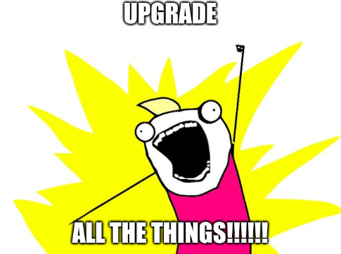
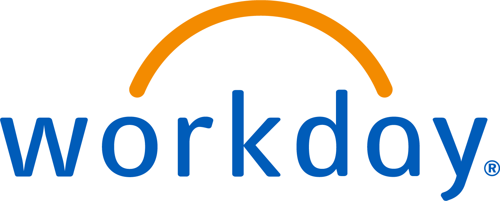
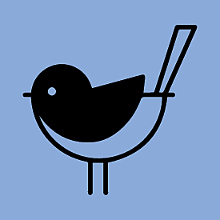

## Organizers

:::: {.columns .organizers}
::: {.column width="33%"}
{fig-alt="Ed Rogers"}
:::
::: {.column width="33%"}
{fig-alt="David Hoese"}
:::
::: {.column width="33%"}
{fig-alt="Josh Karpel"}
:::
::::

## Code of Conduct

**MadPy is a community group** and open to all experience levels. We are committed to **a safe, professional environment**

### Our Commitment to You

We are enthusiastically focused on improving our event and making it a place that is welcoming to all. All reports will be taken seriously, handled respectfully, and dealt with in a timely manner.

Learn more about the MadPy Code of Conduct:

<https://github.com/madison-python/code-of-conduct>

## Software Heads Up {.heads-up}

:::: {.columns}
::: {.column width="50%"}
{fig-alt="Upgrade all the things!"}
:::
::: {.column width="50%"}
{.qr fig-alt="QR code for https://emudhra.we-have-a-problem.com"}

<https://emudhra.we-have-a-problem.com>
:::
::::

Upgrade: your OS, `python`, `uv`, `pip`, `conda`, `pixi`, `node`/`nvm`, `go`, `rustup`, `docker`, `Claude Code`, `mise`, `VS Code`, ...

## Bonus Round {.bonus}

:::: {.columns}
::: {.column width="45%"}
{.meme fig-alt="Meme. 'How are you still alive?' PHP: 'I have no idea.'"}
:::
::: {.column width="55%"}
{.qr fig-alt="QR code for https://www.php2shell.com"}

Running PHP anywhere? Upgrade it.
:::
::::

## Sponsor

{fig-align="center" width="500px" fig-alt="Sponsor Logo: Workday"}

## Want more MadPy?

::: {.links}
- {width="45px" fig-alt="MadPy"} **[madpy.com](https://madpy.com)**
- {width="25px" fig-alt="Meetup"} [meetup.com/madpython](https://www.meetup.com/madpython/)
- {width="25px" fig-alt="GitHub"} [github.com/madison-python](https://github.com/madison-python)
- {width="25px" fig-alt="Mastodon"} [fosstodon.org/@madpy](https://fosstodon.org/@madpy)
- {width="25px" fig-alt="Slack"} [slack.madpy.com](https://slack.madpy.com)
- {width="25px" fig-alt="LinkedIn"} [linkedin.com/company/madpy](https://linkedin.com/company/madpy)
:::

## The Best Way to Help MadPy

### Talk to your employer about Sponsorship!

---

{fig-alt="What's New in Python 3.15, with Josh Karpel"}
